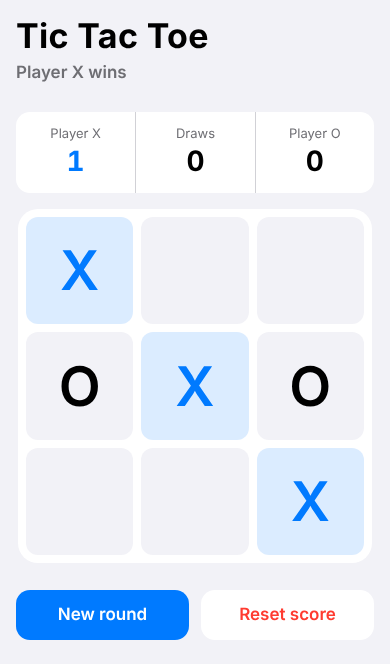

# Tic Tac Toe

Two-player Tic Tac Toe built with React and TypeScript.

## Features

- X and O take turns on a 3x3 board
- Detects wins (rows, columns, diagonals) and draws
- Highlights the winning line
- Score for X, O and draws across rounds
- New round / reset score
- Keyboard and screen-reader friendly, light and dark mode



Demo video: [docs/demo.mp4](docs/demo.mp4)

## Stack

| Layer      | Tool                                  |
| ---------- | ------------------------------------- |
| UI         | React 19 + TypeScript                 |
| Build      | Vite                                  |
| Tests      | Vitest + React Testing Library        |
| Styling    | Plain CSS with design tokens          |
| Hosting    | Vercel                                |

## Project structure

```
src/
  game/
    types.ts         Shared types (Player, BoardState, GameResult, Score)
    logic.ts         Pure game rules, no React
    logic.test.ts    Unit tests for the rules
  hooks/
    useTicTacToe.ts  Game state + actions (playMove, newRound, resetScore)
  components/
    Board.tsx        3x3 grid
    Square.tsx       One cell
    GameStatus.tsx   Turn / winner / draw message
    Scoreboard.tsx   X, draws, O
  App.tsx            Puts the pieces together
  App.test.tsx       Plays a full game through the UI
  index.css          Design tokens and styles
```

Rules live in `game/` as pure functions so they can be tested without rendering anything. The hook owns state; components only render props and call callbacks.

## Run locally

```bash
npm install
npm run dev
```

```bash
npm test
```

```bash
npm run build
```

## Deploy to Vercel

Vercel detects Vite automatically (build: `npm run build`, output: `dist`).

**From GitHub:** push this repo, then on vercel.com choose *Add New → Project*, import the repo, and click *Deploy*.

**From the CLI:**

```bash
npx vercel --prod
```
